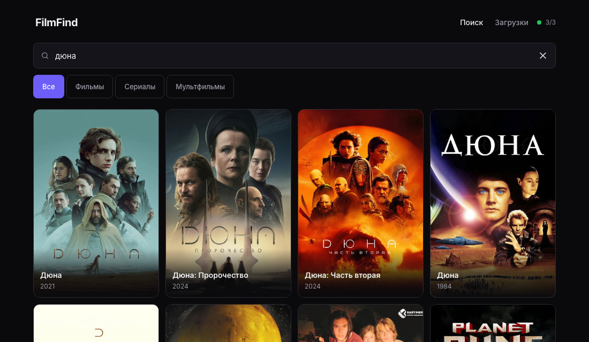
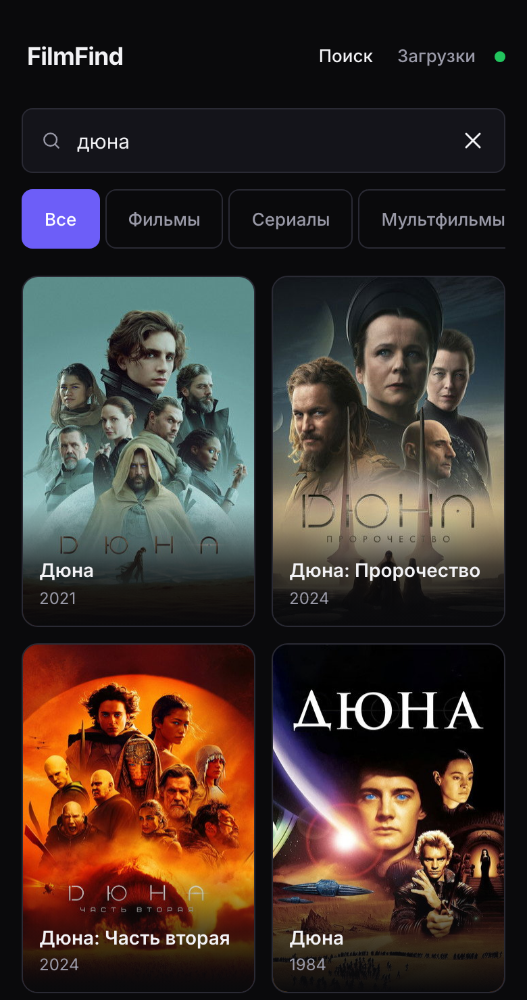
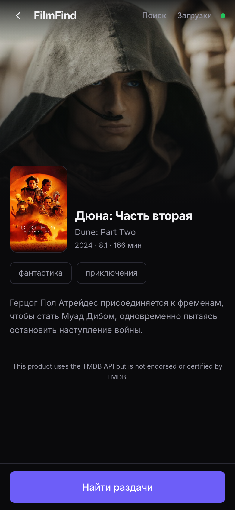
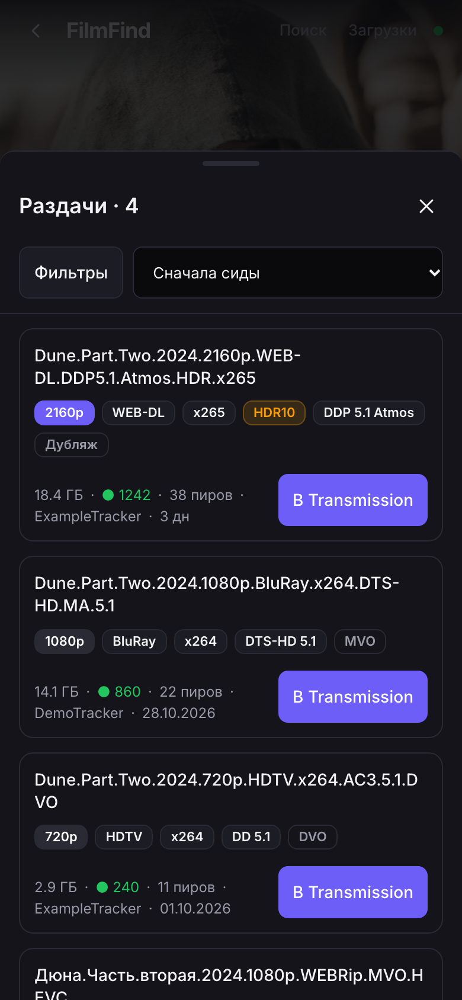

# FilmFind

**English** | [Русский](./README.ru.md)

[](https://github.com/loukash/filmfind/actions/workflows/ci.yml)
[](https://github.com/loukash/filmfind/actions/workflows/docker.yml)
[](https://github.com/loukash/filmfind/pkgs/container/filmfind)
[](./LICENSE)

A self-hosted web app for browsing movies and TV shows, finding releases
through Prowlarr and sending the one you pick to Transmission.

One container: a Fastify server serves the built React frontend and proxies
requests to TMDB / Prowlarr / Transmission, so the browser never needs direct
access to your internal services.

The project is an npm-workspaces monorepo (`apps/server`, `apps/web`,
`packages/shared`): a shared type contract (`@filmfind/shared`), Fastify 5 +
TypeScript with env validation, React 19 + Vite + Tailwind CSS v4 with a
design system, and a multi-stage Docker build.

## Screenshots

<p align="center">
  
</p>

<p align="center">
  
  
  
</p>

## Features

- Search movies and TV shows via TMDB with posters, cards and title details
  (year, genres, overview, IMDb ID).
- Find releases for the selected title through Prowlarr: quality badges
  (1080p, WEB-DL and so on), size, seeders and indexer.
- Send a release to Transmission in one click (magnet, `.torrent` or a
  `releaseId` from the local index) and watch the download list.
- Poster proxying through the server (`/api/img/...`) — the browser never
  talks to TMDB directly, and everything sensitive (magnets, `.torrent`
  links, API keys) stays on the server.
- Security: optional shared access token, per-IP rate limiting, strict CSP
  and other security headers, secret redaction in logs.
- A single Docker Compose container; search history lives in browser
  `localStorage`.

## Quick start (Docker)

The image is published to GitHub Container Registry on every release tag.

```bash
cp .env.example .env
# edit .env: TMDB_API_KEY at minimum
docker compose up -d
```

App: <http://localhost:8080>. Service status:

```bash
curl -s http://localhost:8080/api/health | jq
```

Image: `ghcr.io/loukash/filmfind:latest`, built for `linux/amd64` and
`linux/arm64`. Pushing the git tag `v1.2.3` produces `1.2.3`, `1.2` and
`latest`; branch pushes do not rebuild the image.

### Building from source

Use it when you change the code or your architecture is not covered:

```bash
cp .env.example .env
docker build -t ghcr.io/loukash/filmfind:latest .
docker compose up -d
```

The build is tagged with the same name `docker-compose.yml` expects, so
everything afterwards works exactly as with the prebuilt image. For the
turnkey stack use the same commands with `-f docker-compose.full.yml`.


If Prowlarr or Transmission run on the host, enable option B in
`docker-compose.yml` (`extra_hosts`) and use
`http://host.docker.internal:9696` and `http://host.docker.internal:9091`.
If they are containers on a shared Docker network, enable option A
(`networks`) and address them by container name. See
"Networking for Prowlarr and Transmission" below.

### Turnkey stack: FilmFind + Prowlarr + Transmission

If Prowlarr and Transmission are not running yet, use
[`docker-compose.full.yml`](./docker-compose.full.yml) — it brings up
everything from scratch:

```bash
cp .env.example .env
# fill in TMDB_API_KEY and TRANSMISSION_PASSWORD
mkdir -p downloads/complete/film downloads/complete/tv downloads/complete/mult
docker compose -f docker-compose.full.yml up -d
```

Prowlarr starts empty. Open <http://localhost:9696>, add indexers, copy the API
Key from Settings → General into `.env` as `PROWLARR_API_KEY`, then restart the
app:

```bash
docker compose -f docker-compose.full.yml up -d filmfind
```

| Service | Address | Data |
|---|---|---|
| FilmFind | <http://localhost:8080> | — |
| Prowlarr | <http://localhost:9696> | `./data/prowlarr` |
| Transmission | <http://localhost:9091> | `./data/transmission`, downloads in `./downloads` |

Already wired up for you:

- FilmFind gets the internal addresses `http://prowlarr:9696` and
  `http://transmission:9091/transmission/rpc` from compose — no need to put
  them in `.env`;
- the Transmission RPC login comes from `TRANSMISSION_PASSWORD`, and FilmFind
  receives the same credentials automatically;
- `WHITELIST` includes Docker subnets (`172.*.*.*`, `10.*.*.*`), so requests
  from the neighbouring container are not rejected with 403;
- downloads are sorted into `downloads/complete/film`, `tv` and `mult`.

`PUID`/`PGID` default to `1000` — adjust them to your host user, otherwise
Transmission cannot write into `./downloads`.

## Access token (APP_ACCESS_TOKEN)

By default the API is open to the whole local network. If other people can
reach the app, set a shared token:

```bash
# in .env
APP_ACCESS_TOKEN=<openssl rand -hex 32>
```

After restarting the container every `/api/*` request requires:

```
Authorization: Bearer <APP_ACCESS_TOKEN>
```

A missing or wrong token returns `401 {"code": "UNAUTHORIZED"}`. The frontend
keeps the token in `localStorage` (key `filmfind.token`) and attaches it
automatically.

**Exception:** `/api/health` stays public even when a token is set. It is used
by the Docker healthcheck (`wget http://127.0.0.1:8080/api/health`) and by the
status indicator shown before the token is entered. The health response
contains no secrets, only ok/degraded per service.

Checking from a terminal:

```bash
TOKEN=$(grep '^APP_ACCESS_TOKEN=' .env | cut -d= -f2)
curl -H "Authorization: Bearer $TOKEN" http://localhost:8080/api/releases?type=movie&q=dune
```

## Rate limiting

Per-IP limiting with no external dependencies (in-memory, one-minute window):

| Endpoint | Limit |
|---|---|
| `/api/titles/search`, `/api/releases` | 60/min per IP |
| `/api/transmission/add` | 20/min per IP |
| other `/api/*` (health, title details, posters) | 300/min per IP |

Exceeding a limit returns `429 {"code": "RATE_LIMITED"}` with `Retry-After`.
Every `/api/*` response carries `X-RateLimit-Limit` and
`X-RateLimit-Remaining`. The counter uses `request.ip`. Behind a reverse proxy
all clients share one IP — enable Fastify's `trustProxy` if you need the real
address from `X-Forwarded-For`; for a single-proxy self-hosted setup this is
usually unnecessary.

## Networking for Prowlarr and Transmission

The filmfind container must be able to reach the addresses from `.env`
(`PROWLARR_URL`, `TRANSMISSION_URL`). Two options:

**Option A — shared Docker network** (Prowlarr and Transmission are containers
too):

```bash
docker network ls      # find the network Prowlarr/Transmission live in
                       # (docker inspect <container> | grep -A3 Networks)
docker network create media   # if the network does not exist yet
```

In `docker-compose.yml` uncomment the `networks: - media` block for the service
and at the end of the file, adjusting `DOCKER_NETWORK` if needed. Addresses in
`.env` use container names: `http://prowlarr:9696`,
`http://transmission:9091`.

**Option B — services on the host** (or on another network):

Uncomment `extra_hosts: - "host.docker.internal:host-gateway"`. Addresses in
`.env`: `http://host.docker.internal:9696` and
`http://host.docker.internal:9091`. Works out of the box on macOS/Windows;
on Linux the `host-gateway` entry is already included.

## Local development

Requires Node.js 22+ and npm; the Docker image ships Node 24. CI runs the
build and tests on both 22 and 24.

```bash
npm install
npm run dev
```

- frontend (Vite): <http://localhost:5173>, `/api` is proxied to the server;
- API: <http://localhost:8080>;
- design-system styleguide: <http://localhost:5173/styleguide>.

`npm install` is a one-time step: packages are linked through workspaces.
`npm run dev` builds `@filmfind/shared` before starting the server, so no
separate build command is needed.

Other commands:

```bash
npm run build      # shared → server → web
npm test           # vitest: shared and server
npm run typecheck
```

### Running packages separately

```bash
npm run build -w @filmfind/shared   # required once before running the server alone
npm run dev -w @filmfind/server
npm run dev -w @filmfind/web
```

## Configuring external services

All variables and comments are in [`.env.example`](./.env.example).

### TMDB

1. Sign up at <https://www.themoviedb.org/>.
2. Open Settings → API and get an API Key (v3) or a Read Access Token (v4).
3. Put the value into `TMDB_API_KEY`. A v4 token is detected automatically by
   the `eyJ` prefix and sent as `Authorization: Bearer`.

### Prowlarr

1. Open Prowlarr → Settings → General.
2. Copy the **API Key** into `PROWLARR_API_KEY`.
3. Set `PROWLARR_URL` to the base address, for example
   `http://prowlarr:9696` or `http://host.docker.internal:9696`.

### Transmission

Option 1 — through the Transmission web UI: Settings → Remote → "Allow remote
access" (RPC is enabled by default on port 9091).

Option 2 — by editing Transmission's `settings.json` (then restart the
Transmission container: `docker restart transmission`):

```json
{
  "rpc-enabled": true,
  "rpc-username": "transmission",
  "rpc-password": "{password — Transmission replaces it with a hash on first start}",
  "rpc-whitelist-enabled": true,
  "rpc-whitelist": ["127.0.0.1", "172.17.0.*", "172.18.0.*", "172.19.0.*", "172.20.0.*"]
}
```

- `rpc-whitelist` — add the Docker subnet the filmfind container comes from:
  `172.17.0.*` for the default network, often `172.18.*`–`172.20.*` for a
  Compose network (check with
  `docker network inspect <network> | grep Subnet`). Do not disable the
  whitelist unless you have to.

Then, in FilmFind's `.env`:

1. `TRANSMISSION_URL` — base (`http://host.docker.internal:9091`) or the full
   RPC address (`.../transmission/rpc`).
2. `TRANSMISSION_USER` / `TRANSMISSION_PASSWORD` — if you set
   `rpc-username` / `rpc-password`.
3. Optionally `TRANSMISSION_DOWNLOAD_DIR` — download directory.
4. Optionally `TRANSMISSION_DOWNLOAD_DIR_MOVIE` / `_TV` / `_ANIMATION` — a
   separate directory per category. Animation goes to `_ANIMATION`, other
   movies to `_MOVIE`, series (including anime series) to `_TV`; an unset
   value falls back to `TRANSMISSION_DOWNLOAD_DIR`. The path is inside the
   Transmission container and must exist and be writable by the user from
   `PUID`/`PGID`.

## Security

> **Do not expose FilmFind to the internet without a VPN or a reverse proxy
> with HTTPS and authentication.** The app manages downloads and talks to your
> private services, and Prowlarr API keys grant full access to your indexers —
> they can exhaust rate limits or get you blocked. Keep FilmFind on your local
> network, behind a VPN (Tailscale/WireGuard), or behind a reverse proxy
> (Caddy/nginx/Traefik) with TLS and Basic Auth/OIDC.

What the server already does:

- **Access token** — `APP_ACCESS_TOKEN` protects every `/api/*` with a bearer
  token (see above); comparison is constant-time and the token never reaches
  the logs.
- **Rate limiting** — 60/min for search and releases, 20/min for adding to
  Transmission, 300/min for the rest; token brute force is limited too.
- **CSP and headers** — `default-src 'self'`, `object-src 'none'`,
  `base-uri 'none'`, `frame-ancestors 'none'`, `Permissions-Policy`
  (geolocation/microphone/camera denied), `Cross-Origin-Opener-Policy:
  same-origin`, `X-Content-Type-Options: nosniff`. HSTS is deliberately not
  set: the app runs over HTTP on a local network.
- **Caching** — `/api/*` responses use `Cache-Control: no-store` (except the
  poster proxy, which has a one-day public cache); static assets are served
  with long-lived caching keyed by Vite's hashed filenames.
- **Errors** — in production (`NODE_ENV=production`) 5xx responses do not leak
  internals; secrets live only in `.env` (excluded from git); the Fastify
  logger redacts authorization headers, keys and passwords.

## Limitations

- **No database.** The release index and TMDB/Prowlarr response caches live in
  process memory and are lost on container restart.
- **In-memory cache** — an LRU with an entry cap and TTL; not shared between
  replicas (the app targets a single instance).
- **Search history** is stored in browser `localStorage` and is not synced
  across devices.
- **Only the shell works offline**: without network access to
  TMDB/Prowlarr/Transmission the UI opens, but search and releases do not
  work.
- **Behind a shared reverse proxy the rate limiter treats every client as one
  IP** until `trustProxy` is enabled in Fastify.
- **The UI is Russian-only for now.** The interface strings are not extracted
  for translation yet, so screenshots and labels stay in Russian regardless of
  the README language.

## Legal

FilmFind does not host, index, store or distribute any content. It is a user
interface: it queries TMDB for public metadata, asks your own Prowlarr
instance for releases, and hands the link you pick to your own Transmission
client. No torrent files, magnets or media are bundled with or served by this
project.

The project is not affiliated with TMDB, Prowlarr, Transmission or any
tracker. You are responsible for how you use the app, for complying with the
laws of your jurisdiction, and for the terms of the services you connect.

Metadata and images are provided by TMDB. This product uses the TMDB API but
is not endorsed or certified by TMDB.

## Implementation status

- [x] **Stage 0** — monorepo, `@filmfind/shared` contract, server with
      `/api/health`, design system, styleguide, Docker.
- [x] **Stage 1** — TMDB client: search, title page, poster proxy.
- [x] **Stage 2** — Prowlarr client, release quality parser (server side).
- [x] **Stage 3** — Transmission client, sending a release, download list
      (server side).
- [x] **Stage 4** — title page, releases screen, downloads screen.
- [x] **Stage 5** — access token, rate limiting, security headers, PWA, docs.

Acceptance: `npm run build` and `npm test` are green, the Docker image builds
and runs as non-root, Lighthouse scores 100 for Accessibility and Best
Practices. Live verification against real Prowlarr/Transmission/TMDB happens
after `.env` is filled in — until then every client is covered by mocks.

## Structure

```
apps/
  server/        Fastify API + static serving in prod
  web/           React + Vite + Tailwind, design system in src/ui
packages/
  shared/        DTO contract, formatting, quality parser
Dockerfile
docker-compose.yml
docker-compose.full.yml
```

Technical decisions and deviations are documented in [`NOTES.md`](./NOTES.md).
