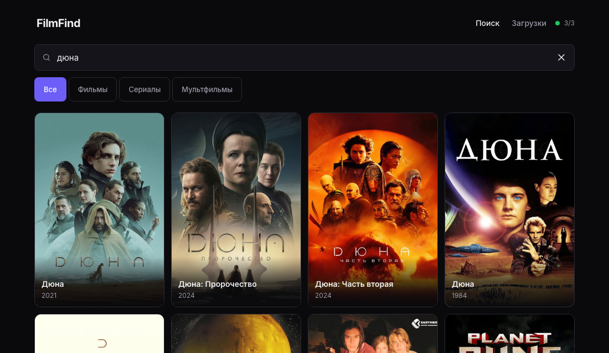
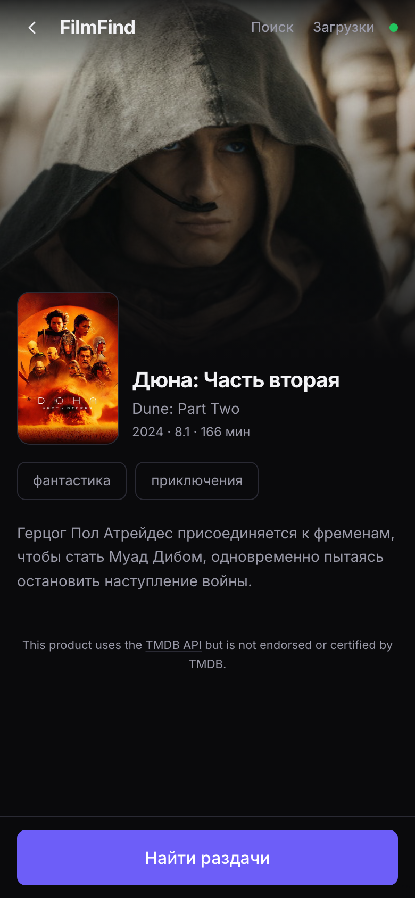
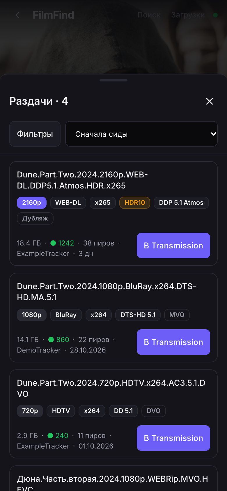

# FilmFind

[English](./README.md) | **Русский**

Self-hosted веб-приложение для поиска фильмов и сериалов, поиска раздач через
Prowlarr и отправки выбранной раздачи в Transmission.

Один контейнер: Fastify-сервер раздаёт собранный React-фронтенд и проксирует
запросы к TMDB / Prowlarr / Transmission, поэтому браузеру не нужен доступ к
внутренним сервисам напрямую.

Само приложение — монорепо на npm workspaces (`apps/server`, `apps/web`,
`packages/shared`): общий контракт типов (`@filmfind/shared`), Fastify 5 +
TypeScript с валидацией env, React 19 + Vite + Tailwind CSS v4 с
дизайн-системой, multi-stage Docker-сборка.

## Скриншоты

<p align="center">
  
</p>

<p align="center">
  
  
  
</p>

## Возможности

- Поиск фильмов и сериалов по TMDB с карточками, постерами и деталями тайтла
  (год, жанры, описание, IMDb ID).
- Поиск раздач по выбранному тайтлу через Prowlarr: список с качеством
  (1080p, WEB-DL и т.п.), размером, сидерами и индексаторами.
- Отправка раздачи в Transmission одним кликом (магнит, .torrent или
  releaseId из локального индекса) и просмотр списка загрузок.
- Прокси постеров через сервер (`/api/img/...`) — браузеру не нужен прямой
  доступ к TMDB; всё внутреннее (магниты, ссылки .torrent, ключи API)
  остаётся на сервере.
- Безопасность: общий токен доступа (опционально), rate limit по IP,
  строгие CSP и другие security-заголовки, маскирование секретов в логах.
- Один контейнер на Docker Compose; история поиска — в localStorage браузера.

## Быстрый старт (Docker)

```bash
cp .env.example .env
# отредактируйте .env: как минимум TMDB_API_KEY
docker compose up -d --build
```

Приложение: <http://localhost:8080>. Проверка состояния сервисов:

```bash
curl -s http://localhost:8080/api/health | jq
```

Если Prowlarr или Transmission запущены на хосте, включите в
`docker-compose.yml` вариант B (`extra_hosts`) и используйте адреса
`http://host.docker.internal:9696` и `http://host.docker.internal:9091`.
Если это контейнеры в общей docker-сети — включите вариант A (`networks`)
и обращайтесь по именам контейнеров. Подробнее — в разделе
«Настройка сети для Prowlarr и Transmission» ниже.

## Токен доступа (APP_ACCESS_TOKEN)

По умолчанию API открыт для всей локальной сети. Если приложением могут
пользоваться не только вы, задайте общий токен:

```bash
# в .env
APP_ACCESS_TOKEN=<openssl rand -hex 32>
```

После перезапуска контейнера все запросы `/api/*` требуют заголовок:

```
Authorization: Bearer <APP_ACCESS_TOKEN>
```

Без заголовка или с неверным токеном — `401 {"code": "UNAUTHORIZED"}`.
Фронтенд хранит токен в `localStorage` (ключ `filmfind.token`) и добавляет
его к запросам автоматически.

**Исключение:** `/api/health` остаётся публичным даже с заданным токеном —
он используется Docker healthcheck (`wget http://127.0.0.1:8080/api/health`)
и индикатором статуса сервиса до ввода токена. Ответ health не содержит
никаких секретов, только ok/degraded по каждому сервису.

Проверка из терминала:

```bash
TOKEN=$(grep '^APP_ACCESS_TOKEN=' .env | cut -d= -f2)
curl -H "Authorization: Bearer $TOKEN" http://localhost:8080/api/releases?type=movie&q=dune
```

## Rate limit

Ограничение по IP без внешних зависимостей (in-memory, окно 1 минута):

| Точка | Лимит |
|---|---|
| `/api/titles/search`, `/api/releases` | 60/мин на IP |
| `/api/transmission/add` | 20/мин на IP |
| остальные `/api/*` (health, детали тайтла, постеры) | 300/мин на IP |

При превышении — `429 {"code": "RATE_LIMITED"}` и заголовок `Retry-After`.
На всех ответах `/api/*` есть `X-RateLimit-Limit` и `X-RateLimit-Remaining`.
Счётчик ведётся по `request.ip`. За обратным прокси все клиенты
приходят с одного IP — при необходимости включите в Fastify `trustProxy`,
чтобы брался реальный адрес из `X-Forwarded-For`; для self-hosted за
одним прокси это обычно не нужно.

## Настройка сети для Prowlarr и Transmission

Контейнеру filmfind нужно, чтобы адреса из `.env` (`PROWLARR_URL`,
`TRANSMISSION_URL`) были доступны изнутри контейнера. Два варианта:

**Вариант A — общая docker-сеть** (Prowlarr и Transmission тоже контейнеры):

```bash
docker network ls      # найдите сеть, в которой живут Prowlarr/Transmission
                       # (docker inspect <имя-контейнера> | grep -A3 Networks)
docker network create media   # если сети ещё нет
```

В `docker-compose.yml` раскомментируйте блок `networks: - media` для сервиса
и в конце файла, при необходимости поправьте `DOCKER_NETWORK`. Адреса в
`.env` — по именам контейнеров: `http://prowlarr:9696`, `http://transmission:9091`.

**Вариант B — сервисы на хосте** (или в другой сети):

Раскомментируйте `extra_hosts: - "host.docker.internal:host-gateway"`.
Адреса в `.env`: `http://host.docker.internal:9696` и
`http://host.docker.internal:9091`. На macOS/Windows работает из коробки,
на Linux строка `host-gateway` уже добавлена.

## Локальная разработка

Требуется Node.js 22+ (проверено на Node 25) и npm.

```bash
npm install
npm run dev
```

- фронтенд (Vite): <http://localhost:5173>, `/api` проксируется на сервер;
- API: <http://localhost:8080>;
- стайлгайд дизайн-системы: <http://localhost:5173/styleguide>.

`npm install` достаточно выполнить один раз: пакеты связываются через
workspaces. `npm run dev` сам собирает `@filmfind/shared` перед запуском
сервера, поэтому отдельная команда сборки не нужна.

Другие команды:

```bash
npm run build      # shared → server → web
npm test           # vitest: shared и server
npm run typecheck
```

### Отдельный запуск пакетов

```bash
npm run build -w @filmfind/shared   # обязательно один раз перед запуском server отдельно
npm run dev -w @filmfind/server
npm run dev -w @filmfind/web
```

## Настройка внешних сервисов

Все переменные и комментарии — в [`.env.example`](./.env.example).

### TMDB

1. Зарегистрируйтесь на <https://www.themoviedb.org/>.
2. Откройте Settings → API и получите API Key (v3) или Read Access Token (v4).
3. Укажите значение в `TMDB_API_KEY`. Токен v4 определяется автоматически по
   префиксу `eyJ` и отправляется как `Authorization: Bearer`.

### Prowlarr

1. Откройте Prowlarr → Settings → General.
2. Скопируйте **API Key** в `PROWLARR_API_KEY`.
3. В `PROWLARR_URL` укажите базовый адрес, например `http://prowlarr:9696`
   или `http://host.docker.internal:9696`.

### Transmission

Способ 1 — через веб-интерфейс Transmission: Settings → Remote →
«Allow remote access» (RPC включён по умолчанию на порту 9091).

Способ 2 — правкой `settings.json` Transmission (затем перезапуск
контейнера Transmission: `docker restart transmission`):

```json
{
  "rpc-enabled": true,
  "rpc-username": "transmission",
  "rpc-password": "{пароль — Transmission сам заменит на хэш при первом запуске}",
  "rpc-whitelist-enabled": true,
  "rpc-whitelist": ["127.0.0.1", "172.17.0.*", "172.18.0.*", "172.19.0.*", "172.20.0.*"]
}
```

- `rpc-whitelist` — добавьте подсеть docker-сети, из которой приходит
  контейнер filmfind: для сети по умолчанию это `172.17.0.*`, для
  compose-сети — часто `172.18.*`–`172.20.*` (проверьте:
  `docker network inspect <сеть> | grep Subnet`). Не отключайте whitelist
  без необходимости.

Дальше в `.env` FilmFind:

1. `TRANSMISSION_URL` — база (`http://host.docker.internal:9091`) или полный
   RPC-адрес (`.../transmission/rpc`).
2. `TRANSMISSION_USER` / `TRANSMISSION_PASSWORD` — если задали
   `rpc-username` / `rpc-password`.
3. Необязательно `TRANSMISSION_DOWNLOAD_DIR` — каталог загрузок.
4. Необязательно `TRANSMISSION_DOWNLOAD_DIR_MOVIE` / `_TV` / `_ANIMATION` —
   разные каталоги по категории. Мультфильмы идут в `_ANIMATION`, остальные
   фильмы в `_MOVIE`, сериалы (включая аниме-сериалы) в `_TV`; незаданное
   значение падает на `TRANSMISSION_DOWNLOAD_DIR`. Путь указывается внутри
   контейнера Transmission, каталог должен существовать и быть доступен на
   запись пользователю из `PUID`/`PGID`.

## Безопасность

> **Не публикуйте FilmFind в интернет без VPN или reverse proxy с HTTPS и
> аутентификацией.** Приложение управляет загрузками и обращается к вашим
> приватным сервисам, а ключи Prowlarr дают полный доступ к вашим
> индексаторам и могут исчерпать лимиты или привлечь блокировки. Держите
> FilmFind в локальной сети, за VPN (Tailscale/WireGuard) или за reverse
> proxy (Caddy/nginx/Traefik) с TLS и Basic Auth/OIDC.

Что уже встроено на уровне сервера:

- **Токен доступа** — `APP_ACCESS_TOKEN` закрывает все `/api/*` Bearer-токеном
  (см. раздел выше); сравнение constant-time, токен не попадает в логи.
- **Rate limit** — 60/мин на поиск и раздачи, 20/мин на добавление в
  Transmission, 300/мин на остальное; перебор токена тоже ограничен.
- **CSP и заголовки** — `default-src 'self'`, `object-src 'none'`,
  `base-uri 'none'`, `frame-ancestors 'none'`, `Permissions-Policy`
  (геолокация/микрофон/камера запрещены), `Cross-Origin-Opener-Policy:
  same-origin`, `X-Content-Type-Options: nosniff`. HSTS сознательно
  не ставится: приложение работает по HTTP в локальной сети.
- **Кэш** — ответы `/api/*` отдаются с `Cache-Control: no-store` (кроме
  прокси постеров — там публичный кэш на день), статика раздаётся с
  длинным кэшем по хэшированным именам Vite.
- **Ошибки** — в прод-режиме (NODE_ENV=production) ответы 5xx не раскрывают
  внутренние детали; секреты хранятся только в `.env` (исключён из git);
  логгер Fastify маскирует заголовки авторизации, ключи и пароли.

## Ограничения

- **Нет базы данных.** Индекс раздач и кэши ответов TMDB/Prowlarr живут в
  памяти процесса; после перезапуска контейнера всё обнуляется.
- **Кэш в памяти** — LRU с ограничением по числу записей и TTL; не шарится
  между репликами (приложение рассчитано на один инстанс).
- **История поиска** хранится в `localStorage` браузера и не синхронизируется
  между устройствами.
- **Офлайн доступна только оболочка**: без сети к TMDB/Prowlarr/Transmission
  интерфейс откроется, но поиск и раздачи работать не будут.
- **За общим reverse proxy счётчик rate limit считает всех как один IP**
  до включения `trustProxy` в Fastify.
- **Интерфейс пока только на русском.** Строки не вынесены в файлы перевода,
  поэтому подписи и скриншоты остаются на русском независимо от языка README.

## Правовая оговорка

FilmFind не хранит, не индексирует и не распространяет контент. Это
пользовательский интерфейс: он запрашивает публичные метаданные у TMDB,
обращается к вашему собственному инстансу Prowlarr за раздачами и передаёт
выбранную вами ссылку в ваш собственный клиент Transmission. Ни торрент-файлы,
ни магниты, ни медиафайлы не входят в этот проект и не отдаются им.

Проект не связан с TMDB, Prowlarr, Transmission и какими-либо трекерами.
Ответственность за использование приложения и за соблюдение законодательства
вашей юрисдикции, а также условий подключённых сервисов, лежит на вас.

Данные и изображения предоставлены TMDB. Этот продукт использует TMDB API,
но не одобрен и не сертифицирован TMDB.

## Статус реализации

- [x] **Этап 0** — монорепо, контракт `@filmfind/shared`, сервер с `/api/health`,
      дизайн-система, стайлгайд, Docker.
- [x] **Этап 1** — клиент TMDB: поиск, карточка тайтла, прокси постеров.
- [x] **Этап 2** — клиент Prowlarr, парсер качества релизов (серверная часть).
- [x] **Этап 3** — клиент Transmission, отправка раздачи, список загрузок (сервер).
- [x] **Этап 4** — карточка тайтла, экран раздач, экран загрузок.
- [x] **Этап 5** — токен доступа, rate limit, заголовки безопасности, PWA, README.

Приёмка: `npm run build` и `npm test` зелёные, Docker-образ собирается и
запускается не от root, Lighthouse даёт 100 по Accessibility и Best Practices.
Живая проверка против реальных Prowlarr/Transmission/TMDB выполняется после
заполнения `.env` — до этого все клиенты проверены на моках.

## Структура

```
apps/
  server/        Fastify API + раздача статики в prod
  web/           React + Vite + Tailwind, дизайн-система в src/ui
packages/
  shared/        DTO-контракт, форматирование, парсер качества
Dockerfile
docker-compose.yml
```

Технические решения и отклонения описаны в [`NOTES.md`](./NOTES.md).
